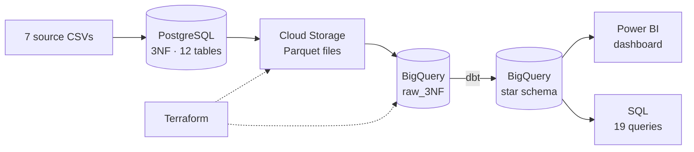
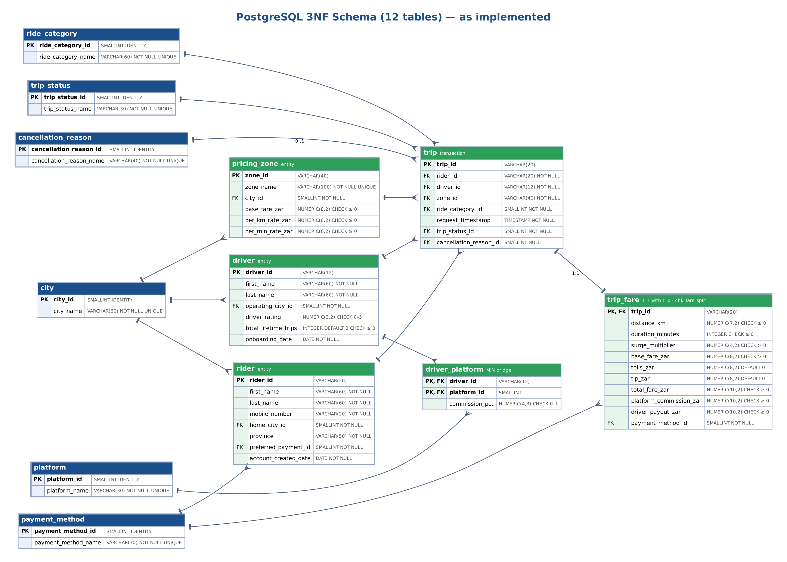
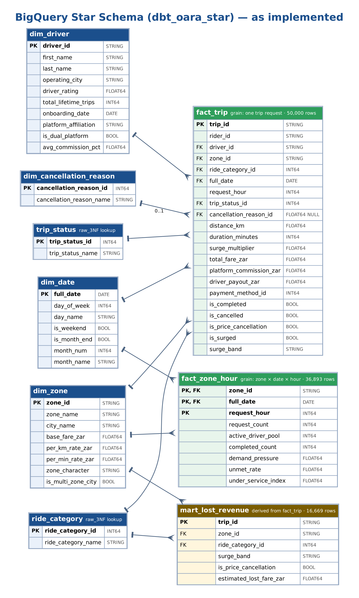
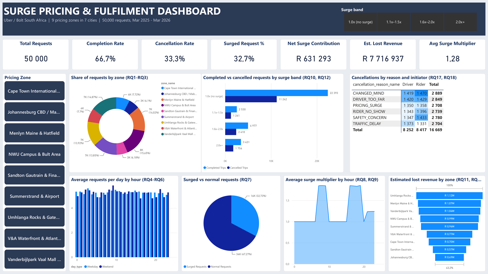
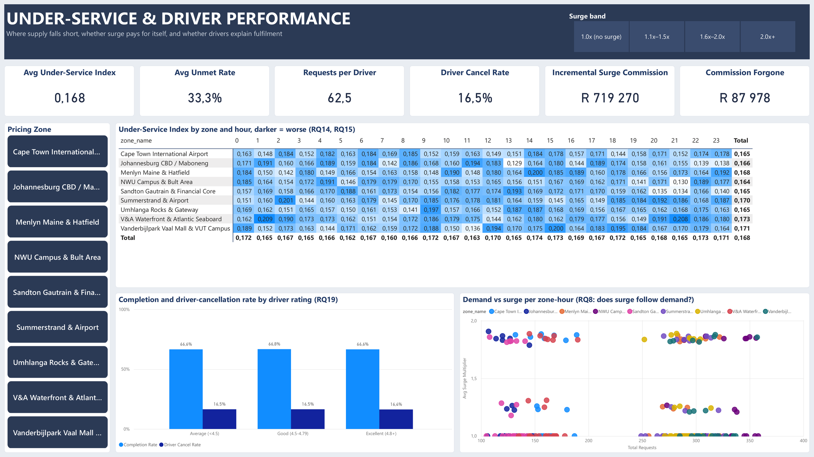

# Demand Hotspots, Surge Pricing & Under-Serviced Zones

**CMPG321 · Group 30 · TECHNOVATORS Solutions**

An end-to-end data platform and analysis of **50,000 Uber and Bolt trip requests** across **9 pricing zones in 7 South African cities**, from March 2025 to March 2026. The raw CSVs are normalised in PostgreSQL, copied to Google Cloud Storage and BigQuery, modelled into a star schema with dbt, and analysed with SQL and a Power BI dashboard.

> **Main question:** Is the platform's dynamic surge pricing making the company profit without compromising customer fulfilment and satisfaction?
>
> **Answer:** Surge pays (net **+R631,293** over 13 months, about 19% of all commission) and does not hurt fulfilment (completion stays at **66–67%** in every surge band). But it is not dynamic: it follows the clock, not demand.

---

## Key findings

| # | Finding | Evidence |
|---|---|---|
| 1 | **There are no real demand hotspots.** | Every city gets 6,141–7,825 requests and about 62–63 requests per registered driver. Hourly volume stays within ±6% of the average hour, and weekend evenings and month-ends look like any other time. (RQ1–RQ6) |
| 2 | **Surge follows a fixed timetable, not demand.** | Every request from 07:00–09:59 and 16:00–19:59 is surged (about 1.85×), about 28% from 21:00–23:59, and none at other hours. The correlation between demand and surge across zone-date-hour cells is **0.0002**, and peak surge is 1.83–1.86× in every zone. (RQ7–RQ9) |
| 3 | **Surge does not hurt fulfilment.** | Completion is 66.1–67.4% in every surge band. Price-related cancellations are about 16% of cancellations in every band, including when there is no surge. (RQ10, RQ12) |
| 4 | **Surge pays.** | It adds R719,270 in commission and costs R87,978 in commission lost to price cancellations: a net **+R631,293**, about 19% of all commission. (RQ13) |
| 5 | **The real problem is failed requests.** | 1 in 3 requests (16,669 of 50,000) is cancelled, worth an estimated **R7.72 million** in fares. Failures are spread evenly across the six reasons (16–17% each), riders and drivers, zones, hours, platforms and driver-rating tiers. (RQ11, RQ14–RQ19) |

### What stakeholders can do with this

- **Pricing team:** relabel surge as peak-time pricing, or rebuild it to react to requests per available driver, while keeping the roughly R630,000 it earned over the 13 months.
- **Operations:** cut the one-in-three failure rate with a tighter dispatch radius, no-show rules and better safety handling. Each percentage point recovered is about 500 trips and R50,000 in commission over the period.
- **Data team:** log driver availability, add a public-holiday and academic-term calendar, and check how cancellation reasons are captured.

---

## Architecture



The flow is one-way: data moves from PostgreSQL to the cloud, and nothing writes back.

| Stage | Tool | What happens | Code |
|---|---|---|---|
| Operational database | PostgreSQL 16 + pgAdmin, in Docker | The CSVs are split into 12 normalised tables with primary keys, foreign keys and CHECK constraints, in one transaction | `docker-compose.yml`, `sql/schema2.sql`, `scripts/load_data_postgres.py` |
| Data lake | Google Cloud Storage | Each table is copied as-is to `gs://<bucket>/3NF/<table>/<table>.parquet` | `scripts/extract_to_gcs.py` |
| Raw warehouse | BigQuery, dataset `raw_3NF` | The Parquet files load into 12 tables, replaced in full on every run | `scripts/load_to_bigquery.py` |
| Star schema | dbt on BigQuery | Fact tables, dimensions and a lost-revenue mart, with data tests | `dbt_uber/` |
| Infrastructure | Terraform | Creates the bucket and the BigQuery datasets in `africa-south1` | `terraform/` |
| Analysis | BigQuery SQL, Power BI | 19 research-question queries and a 2-page dashboard | `analysis/`, `.pbix` file |

---

## Data

The seven CSVs supplied with the CMPG321 project brief are in `Data/Raw/`. Five of them feed the pipeline.

| File | Rows | Loaded into |
|---|---:|---|
| `pricing_surge_zones.csv` | 9 | `pricing_zone`, `city` |
| `sa_drivers.csv` | 800 | `driver`, `driver_platform`, `city` |
| `sa_riders.csv` | 1,200 | `rider`, `city` |
| `trip_headers.csv` | 50,000 | `trip`, `ride_category`, `trip_status`, `cancellation_reason` |
| `trip_fare_breakdown.csv` | 50,000 | `trip_fare`, `payment_method` |
| `vehicles.csv` | 800 | not loaded |
| `trip_reviews.csv` | 25,055 | not loaded |

---

## Data model

### PostgreSQL (3NF)

- **6 lookup tables** (`city`, `platform`, `ride_category`, `trip_status`, `cancellation_reason`, `payment_method`) replace repeated text values with keys.
- **4 core tables:** `rider`, `pricing_zone`, `driver`, and `driver_platform`. Drivers listed as "Dual-Platform (Both)" become two rows in `driver_platform`, which resolves the many-to-many link between drivers and platforms.
- **`trip` and `trip_fare`** are one-to-one. The `chk_fare_split` constraint checks that commission plus driver payout equals the total fare, to within 2 cents.
- "N/A" cancellation reasons are stored as NULL.

Row counts after loading:

| Table | Rows | Table | Rows |
|---|---:|---|---:|
| `city` | 7 | `rider` | 1,200 |
| `platform` | 2 | `pricing_zone` | 9 |
| `ride_category` | 4 | `driver` | 800 |
| `trip_status` | 3 | `driver_platform` | 1,059 |
| `cancellation_reason` | 6 | `trip` | 50,000 |
| `payment_method` | 5 | `trip_fare` | 50,000 |



### BigQuery star schema (dbt)

| Table | Grain | Rows | Holds |
|---|---|---:|---|
| `fact_trip` | one trip request | 50,000 | Trip and fare measures, plus the flags `is_completed`, `is_cancelled`, `is_price_cancellation`, `is_surged` and `surge_band` |
| `fact_zone_hour` | zone × date × hour | 36,893 | Requests, active drivers, demand pressure, unmet rate and the Under-Service Index |
| `mart_lost_revenue` | one cancelled request | 16,669 | Estimated lost fare: the average completed fare for the same zone and ride category |
| `dim_date` | one day | 396 | Day of week, weekend and month-end flags |
| `dim_driver` | one driver | 800 | City, rating, and a platform label built from the many-to-many link |
| `dim_zone` | one pricing zone | 9 | City, fare rates, multi-zone-city flag |
| `dim_cancellation_reason` | one reason | 6 | Cancellation reason names |

**Under-Service Index** = 0.5 × scaled demand pressure + 0.5 × scaled unmet rate, where demand pressure = requests ÷ distinct active drivers, unmet rate = 1 − completed ÷ requests, and both are min-max scaled to 0–1.

dbt writes these tables to `<your dbt dataset>_star`. The build used for the analysis is `dbt_oara_star`. Data tests (`not_null`, `unique`, `accepted_values`, `relationships`) are in `dbt_uber/models/marts/shema.yml`.

`cancellation_reason_id` arrives in BigQuery as FLOAT64, because pandas turns an integer column with NULLs into floats when it writes Parquet. The queries cast it to INT64 before joining.



---

## Analysis

The 19 research questions fall into six themes. All queries are in [`analysis/rq_queries_bigquery.sql`](analysis/rq_queries_bigquery.sql).

| Theme | Research questions |
|---|---|
| A. Spatial demand concentration | RQ1 share of requests by zone · RQ2 city vs zone ranking · RQ3 requests per registered driver |
| B. Temporal rhythms | RQ4 24-hour cycle · RQ5 weekend evenings · RQ6 month-ends and holidays |
| C. Surge behaviour | RQ7 surge distribution · RQ8 does surge follow demand? · RQ9 surge across zones |
| D. Effectiveness and profit | RQ10 completion by surge band · RQ11 unfulfilled demand in rand · RQ12 price-driven cancellations · RQ13 net surge profit |
| E. Under-serviced zones | RQ14 requests per active driver · RQ15 Under-Service Index · RQ16 ride mix in under-served cells |
| F. Cancellations and fulfilment | RQ17 cancellations by reason and initiator · RQ18 by zone and time of day · RQ19 driver attributes |

**SQL techniques used:** inner and left joins; CTEs and scalar subqueries; window functions (`RANK`, `DENSE_RANK` with `QUALIFY`, `NTILE`, running `SUM`, `AVG() OVER`); conditional aggregation (`COUNTIF`, `IF`, `CASE`); `CORR`; `UNION ALL`; and date functions. In PostgreSQL, the work also uses identity keys, constraints, and a single-transaction load.

### Query optimisation

BigQuery bills by bytes scanned, so each query was dry-run twice: once against the 3NF tables with joins and `SELECT *`, and once against the star schema reading only the columns it needs.

| Query | Before (bytes) | After (bytes) | Saving |
|---|---:|---:|---:|
| RQ10 Completion by surge band | 9,375,319 | 803,418 | 91.4% |
| RQ8 Average surge by zone and hour | 9,375,104 | 1,691,035 | 82.0% |
| RQ13 Incremental surge commission | 9,374,463 | 900,000 | 90.4% |
| RQ15 Under-Service Index by zone and hour | 4,141,540 | 1,246,290 | 69.9% |
| **Total** | **32,266,426** | **4,640,743** | **85.6%** |

Three changes produce the saving:

- **Column pruning:** BigQuery stores data by column, so reading fewer columns scans fewer bytes.
- **Fewer joins:** `fact_trip` already holds the status flags, surge band and zone key.
- **Pre-aggregation:** `fact_zone_hour` stores the zone-hour grain once.

---

## Dashboard

The Power BI report connects to the star schema in BigQuery. **Pricing Zone** and **Surge band** slicers filter both pages. The same 50,000 trips are counted in PostgreSQL, in BigQuery `raw_3NF`, in `fact_trip`, and on the dashboard's Total Requests card.

**Page 1: Surge Pricing & Fulfilment** covers demand by zone and hour, surge by hour, completion by surge band, cancellations by reason and initiator, and lost revenue by zone.



**Page 2: Under-Service & Driver Performance** has the Under-Service Index heat map by zone and hour, completion by driver rating, and demand against surge for each zone-hour.



---

## Getting started

### Prerequisites

- Docker Desktop (with WSL2 integration on Windows)
- Python 3.10+
- Google Cloud CLI (`gcloud`), for the cloud steps
- Terraform, for the technical lead only
- Power BI Desktop, to open the dashboard

### 1. Clone and configure

```bash
git clone https://github.com/Oara-IT/technovators-database-2.git
cd technovators-database-2
```

Create a `.env` file in the repo root. It is listed in `.gitignore`, so it never gets committed.

```dotenv
# PostgreSQL and pgAdmin: local only, choose your own values
POSTGRES_USER=technovators
POSTGRES_PASSWORD=change-me
POSTGRES_DB=ride_hailing
PG_HOST=localhost
PG_PORT=5432
PGADMIN_EMAIL=admin@example.com
PGADMIN_PASSWORD=change-me

# Google Cloud: only needed for the extract and load steps
GCP_PROJECT_ID=technovators
GCS_BUCKET=technovators-cmpg321-2026-raw
```

The extract and load scripts can also read a service-account key from a `GCP_KEY` variable, as one line of JSON. Without it, they use your own `gcloud` login.

### 2. Start PostgreSQL and pgAdmin

```bash
docker compose up -d
docker compose ps        # postgres should show "healthy"
```

### 3. Load the CSVs into PostgreSQL

Run these from the repo root:

```bash
python3 -m venv .venv
source .venv/bin/activate
pip install -r requirements.txt
python scripts/load_data_postgres.py
```

The script recreates the 12 tables from `sql/schema2.sql` and loads them in one transaction, so a failure leaves nothing half-loaded. It prints each table's row count; compare them with the table under [Data model](#data-model).

To browse the tables, open <http://localhost:5050>, log in with your pgAdmin email and password, and register a server with:

- host `postgres` (not `localhost`)
- port `5432`
- the user, password and database from your `.env`

### 4. Create the cloud resources (technical lead)

```bash
cd terraform
terraform init
terraform plan
terraform apply
```

This creates the bucket `technovators-cmpg321-2026-raw` and the BigQuery datasets `raw_3NF` and `star`, all in `africa-south1`.

### 5. Copy PostgreSQL to BigQuery

```bash
gcloud auth application-default login   # skip if GCP_KEY is set
python scripts/extract_to_gcs.py        # 12 tables -> Parquet in Cloud Storage
python scripts/load_to_bigquery.py      # Parquet -> BigQuery raw_3NF (replaces the tables)
```

### 6. Build the star schema with dbt

Ask the technical lead to add your Google account to the project with the **BigQuery Data Viewer**, **BigQuery Job User** and **BigQuery Data Editor** roles. Then create `~/.dbt/profiles.yml`:

```yaml
dbt_uber:
  target: dev
  outputs:
    dev:
      type: bigquery
      method: oauth
      project: technovators
      dataset: dbt_yourname        # your own development dataset
      location: africa-south1
      threads: 4
```

```bash
gcloud auth application-default login
cd dbt_uber
dbt debug    # checks the connection
dbt run      # builds the tables in dbt_yourname_star
dbt test     # runs the data tests
```

### 7. Run the analysis and open the dashboard

- **Queries:** open `analysis/rq_queries_bigquery.sql` in the BigQuery console and run any query. The queries read `dbt_oara_star`; change the dataset name to query your own build.
- **Dashboard:** open the `.pbix` file in Power BI Desktop. To refresh the data, sign in to the Google BigQuery connector with an account that can read the project.

---

## Repository layout

```text
.
├── Data/Raw/                     7 source CSVs (5 are loaded)
├── docker-compose.yml            PostgreSQL 16 + pgAdmin 4
├── requirements.txt              Python dependencies
├── sql/
│   ├── schema2.sql               3NF schema: 12 tables, keys and constraints
│   ├── schema.sql                earlier drivers-only table
│   ├── staging.sql               earlier SQL-based loading approach
│   └── transform.sql             earlier SQL-based loading approach
├── scripts/
│   ├── load_data_postgres.py     CSVs -> PostgreSQL, in one transaction
│   ├── extract_to_gcs.py         PostgreSQL -> Parquet in Cloud Storage
│   ├── load_to_bigquery.py       Cloud Storage -> BigQuery raw_3NF
│   ├── load_drivers_postgres.py  earlier drivers-only loader
│   └── testload_data.py          earlier SQL-staging loader
├── terraform/                    Cloud Storage bucket and BigQuery datasets
├── dbt_uber/                     dbt project: star-schema models and tests
├── analysis/
│   └── rq_queries_bigquery.sql   the 19 research-question queries
├── docs/images/                  ERDs and dashboard screenshots
└── *.pbix                        Power BI report
```

---

## Team rules

- Never commit `.env` or key files. `.gitignore` already blocks the usual names.
- Only the technical lead runs Terraform and the extract and load scripts against the shared bucket and datasets.
- Build dbt models in your own `dbt_<name>` dataset, never directly in `raw_3NF`.
- Check with the technical lead before changing `docker-compose.yml` or anything in `terraform/`.

---

## Limitations and next steps

- **No driver availability data:** "active drivers" counts the drivers who received a request in that zone and hour, so idle supply is invisible.
- **No public-holiday or academic-term calendar yet:** RQ6 covers month-ends only.
- **Two CSVs aren't loaded:** `vehicles.csv` and `trip_reviews.csv` are not loaded yet, so satisfaction is measured through completion and cancellations rather than ratings.
- **Cancellation reasons need checking:** all six reasons have almost the same share (16–17%), so confirm how they are captured before acting on them.
- **Full refresh, no partitioning:** every run reloads all tables. As the data grows, load incrementally and partition `fact_trip` by `full_date`, clustered by `zone_id`.
- **The pipeline runs by hand:** the scripts run manually, in order. The next step is to schedule them with an orchestrator.

---

## Team

| Member | Role |
|---|---|
| Oarabile Magopa | Technical lead |
| Babiana Hlatshwayo | Analytics engineer |
| Paul Mwa | Analytics engineer |
| David Ramokgola | Integration engineer |
| Nerissa Manyati | Software engineer |
| Ntshembo Maswanganyi | BI developer |
| Otsile Maletso | BI developer |
